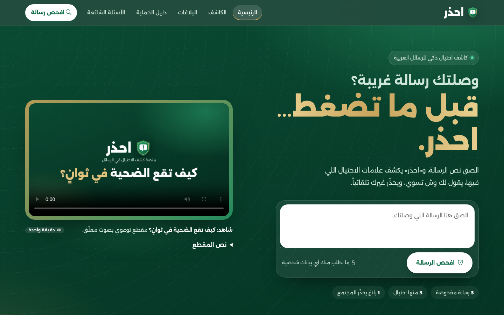
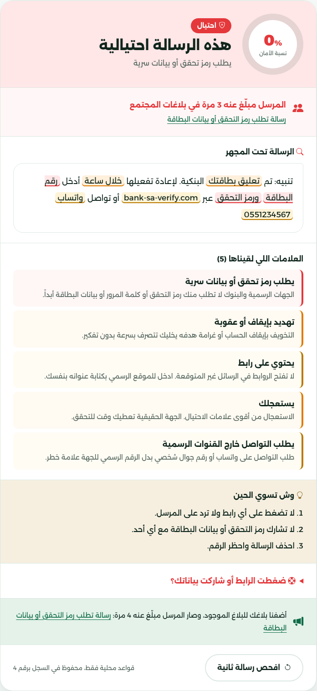
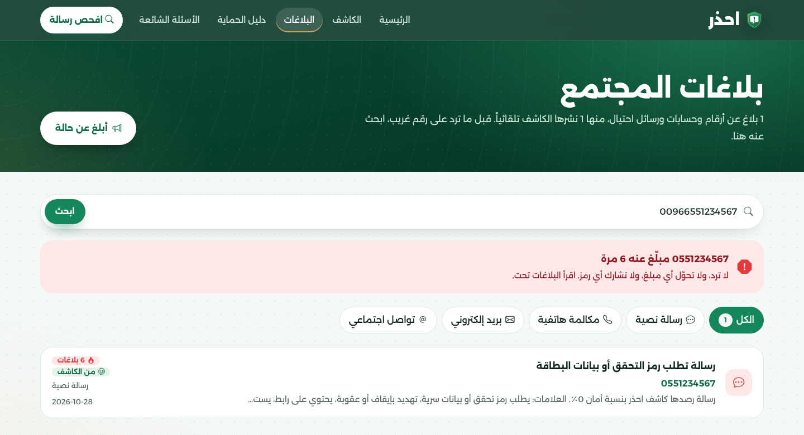
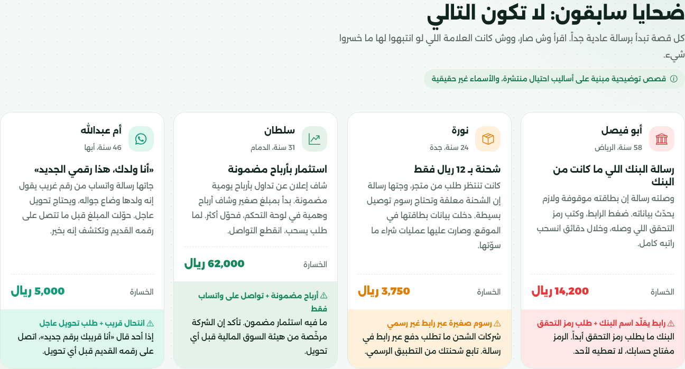

# ⚠️ Ihdhar (احذر): Fraud Message Detector



## Overview
**Ihdhar** ("Beware") is a Django website that helps people in Saudi Arabia spot scam messages **before they click**,
and warns the whole community about them.

The user pastes a suspicious SMS, WhatsApp or email message (or uploads a PDF such as a job contract), and the site returns:
- a **safety score** from 0 to 100 (0 = fraud, 100 = safe),
- the risky words and links **highlighted inside the message itself**,
- clear steps on what to do now, and what to do **if they already clicked**,
- whether the sender's **phone, email or link was reported before** by other people.

If the message is fraud, the site **publishes a community warning automatically** with the scam name and the sender's
number or link. If the same scammer is reported again, the existing report gets **+1** instead of a duplicate.

The detector works in two layers:
1. **Local rules**: 13 fraud signs (OTP requests, fake or shortened links, threats, prizes, a "relative with a new number"...) with 96 Arabic and English patterns.
2. **AI opinion**: an OpenRouter model (`gpt-4o-mini` by default) with a Saudi-specific prompt and calibration examples. It quotes the exact risky words, which are highlighted too.

Both are merged into one final score. Without an API key or internet, the site still works with the local rules.

> Unit 2 project, Tuwaiq Academy Python Bootcamp. It's based on our **Entabih** mobile app (React Native + FastAPI), rebuilt as a server-rendered Django website.
> There is **no database** in this unit: checks, reports and feedback are saved in JSON files inside `data/`.

## Features
- 🔍 **Smart detector** for text messages: safety gauge, highlighted red flags, AI quotes, steps, and "already clicked?" help.
- 📢 **Automatic community warnings**: fraud results are published as reports, and repeated scammers are counted.
- 🔎 **Is this number reported?** Search a phone number in any format (`+966 55…`, `00966…`, `05…`), an email or a link.
- 🎬 **Awareness video** at the top of the home page: a 47-second animated clip with a Saudi-dialect male voice-over and a soft background track, showing how a victim falls for a fake bank message (with a transcript).
- 📖 **Victims' stories**: four illustrative stories built on common scam patterns (names are not real).
- 📄 **PDF analysis**: upload a document and ask a question ("Is this a real job contract?"). Arabic PDFs are read in the right word order.
- 🕘 **Checks history** with a filter by verdict. Saving and publishing are optional for each check.
- 🍪 **Cookies**: the site remembers your detector choices (save / warn the community) and your last 5 number searches, with a button to clear them.
- 📚 **Protection guide** with an illustrated card and a full page for every scam type (the sample message shown on a phone screen, how it works, highlighted samples, real vs fake, protection, what to do if you fell for it, a story and related community reports), **FAQ** and ⭐ **feedback** with a pure-CSS star rating.
- 🌙 **Dark and light mode**: a button in the menu. The server saves the choice in a `theme` cookie for one year, so it works without JavaScript.
- 📱 Fully responsive (RTL), keyboard accessible, and respects *reduced motion*.

## User Stories
As a **visitor** I can:
- Paste a suspicious message and get a safety score, the highlighted risky parts, and steps to follow.
- Know right away if the sender's number, email or link was reported before.
- Warn other people automatically when the message is fraud (or turn this off).
- Search a phone number, email or link before answering an unknown contact.
- Watch a short narrated video and read real-pattern stories to learn how scams work.
- Upload a PDF and ask a question about it.
- See my previous checks, filter them by verdict, and open one.
- Report a scam manually, and get a clear reason if my report is not accepted.
- Read the protection guide and FAQ, and send my feedback with a star rating.
- Switch between dark and light mode, and the site remembers my choice.

## Installation
```bash
# 1. Clone the repository
git clone <your-repo-url>
cd ihdhar

# 2. Create and activate a virtual environment
python -m venv venv
venv\Scripts\activate            # Windows
source venv/bin/activate         # macOS / Linux

# 3. Install the packages
pip install -r requirements.txt

# 4. Add your API key
copy .env.example .env           # Windows   (macOS / Linux: cp .env.example .env)
# then open .env and set OPENROUTER_API_KEY=sk-or-...

# 5. Run the server
python manage.py runserver
```
Open **http://127.0.0.1:8000** in your browser.

> No `migrate` step is needed: this project has no database.

## Usage
| Page | URL | What you do there |
|---|---|---|
| Home | `/` | Watch the video, check a message from the hero, look up a number |
| Detector | `/detector/` | Check a text message (up to 2000 characters) |
| PDF check | `/detector/pdf/` | Upload a PDF (max 5 MB) and ask a question about it |
| History | `/detector/history/` | Saved checks, filter with `?verdict=fraud` / `suspicious` / `safe` |
| Check details | `/detector/history/<id>/` | One saved check |
| Reports | `/reports/` | Browse reports, filter `?type=sms`, look up `?q=0551234567` |
| New report | `/reports/new/` | Publish a report manually (reviewed before publishing) |
| Report details | `/reports/<id>/` | One report, how many times the sender was reported, and other reports about the same sender |
| Guide | `/guide/` | Tips, scam types, detector rules, official channels |
| Scam type | `/guide/<scam_key>/` | One scam type (e.g. `/guide/bank/`): how it works, highlighted samples, real vs fake, protection, what to do, a story and related reports |
| FAQ | `/faq/` | Frequently asked questions |
| Feedback | `/feedback/` | Rate the site and send your opinion |
| Theme | `/theme/` (POST) | The dark / light button in the menu posts here; it saves a cookie and goes back to the same page |

**How to read the score:** `75 - 100` safe, `40 - 74` suspicious, `0 - 39` fraud.

## Output

**Detector result**: score, verdict, community alert, the message under the "x-ray", red flags, steps, and the auto-published warning:



**Number lookup**: the same number written as `00966…` finds the reports saved as `05…`:



**Victims' stories** and the scam samples on the home page:



## Project Structure
```
ihdhar/                         # created with: django-admin startproject ihdhar
├── ihdhar/                     # Project folder (made by startproject)
│   ├── settings.py             # The 3 apps are registered in INSTALLED_APPS, no database, reads .env
│   ├── urls.py                 # include() the urls of every app
│   ├── asgi.py
│   └── wsgi.py
├── main/                       # App: home, guide, FAQ, feedback (+ the shared layout)
│   ├── views.py  ·  urls.py
│   ├── content.py              # Tips, scam types, stories, channels, FAQ text
│   ├── json_store.py           # load / save / add / get records in data/*.json
│   ├── contacts.py             # Find and clean phones, emails and links in a text
│   ├── ai_client.py            # OpenRouter client (requests), returns JSON
│   ├── templates/main/         # base.html (parent of every page), 404.html, partials/, pages
│   └── static/main/
│       ├── css/                # style.css (shared design), fonts.css, Bootstrap RTL, Bootstrap Icons
│       ├── fonts/              # Alexandria + Bootstrap Icons
│       ├── images/             # Logo, Absher & SAMA logos, scams/ (one SVG illustration per scam type), empty & 404 illustrations
│       ├── js/                 # main.js (loading screen, counter, paste)
│       └── videos/             # Awareness video and its poster
├── detector/                   # App: the fraud detector
│   ├── views.py  ·  urls.py
│   ├── rules.py                # The 13 fraud signs and their patterns
│   ├── analyzer.py             # Local scan + AI prompt + final score + highlights
│   ├── pdf_reader.py           # Read PDF text (PyMuPDF, fixes Arabic word order)
│   ├── templates/detector/     # Pages + partials/gauge.html
│   └── static/detector/
│       ├── css/detector.css    # Detector page, result card, gauge, history
│       ├── fonts/              # Changa (from our Entabih app) for the scores
│       └── images/             # scan.svg, pdf.svg
├── reports/                    # App: community reports
│   ├── views.py  ·  urls.py
│   ├── store.py                # Save, match by contact, auto-publish, +1 for repeats
│   ├── report_types.py         # SMS, call, email, social media
│   ├── moderation.py           # Local + AI review of manual reports
│   ├── templates/reports/
│   └── static/reports/
│       ├── css/reports.css     # Number lookup and report details
│       ├── fonts/              # Space Mono (from our Entabih app) for phone numbers and links
│       └── images/             # megaphone.svg
├── data/                       # JSON files created while using the site
├── screenshots/
├── .env.example
├── requirements.txt
├── README.md
└── manage.py
```

## Django Basics Used
| Concept | Example in the project |
|---|---|
| Template inheritance | `main/templates/main/base.html` has ``, ``, ``; every page starts with `` |
| Static files per app | ``, `<link href="">`, `` |
| `for` loop | ` {{ channel.name }} ` in `main/templates/main/home.html` |
| `for` + `empty` + `forloop.counter` | FAQ list in `main/templates/main/faq.html` |
| `if` / `elif` / `else` | Score ranges in `faq.html`, result area in `detector/templates/detector/detector.html` |
| Key: value (dictionary) | `SCORE_RANGES = {"آمنة": "75 - 100", ...}` in `main/content.py`, shown with ``; also `` in `reports/templates/reports/report_list.html` |
| Links | Named URLs ``, and external links from data: `{"url": "https://www.absher.sa"}` → `href="{{ channel.url }}"` |
| Path parameters | `path("guide/<slug:scam_key>/", ...)` in `main/urls.py` (`/guide/bank/`), `path("<int:report_id>/", ...)` in `reports/urls.py`, `path("history/<int:check_id>/", ...)` in `detector/urls.py`; the view receives them as arguments, e.g. `def scam_detail(request, scam_key)`, and links use `` |
| Query parameters | `request.GET.get(...)`: search `/reports/?q=0551234567`, filters `/reports/?type=sms` and `/detector/history/?verdict=fraud`, a filled message box `/detector/?text=...` (from the scam pages), and `/reports/new/?message=...` (from a detector result) |
| `include` | `ihdhar/urls.py` uses `include("main.urls")` …; templates use `` |
| Filters | `{{ check.text|truncatechars:110 }}`, `{{ result.flags|length }}`, `{{ report.message|linebreaksbr }}` |
| Forms | `method="post"` + `` in the detector, new report and feedback pages |
| Cookies | `response = render(...)` gives an `HttpResponse`, then `response.set_cookie("save_checks", "on", max_age=...)` in `detector/views.py`; `request.COOKIES.get(...)` reads it back; recent searches cookie + `response.delete_cookie(...)` in `reports/views.py`; the `theme` cookie in `main/views.py` (`toggle_theme`) is read in `base.html` with `request.COOKIES.theme` |

## Built With
- [Django 5.2](https://www.djangoproject.com/): views, URLs, templates, static files
- [Bootstrap 5 RTL](https://getbootstrap.com/) + [Bootstrap Icons](https://icons.getbootstrap.com/)
- [OpenRouter](https://openrouter.ai/): AI model for the second opinion
- [PyMuPDF](https://pypi.org/project/PyMuPDF/): reading PDF text
- Font: [Alexandria](https://fonts.google.com/specimen/Alexandria)
- Video voice-over: [Piper TTS](https://github.com/rhasspy/piper), Saudi male voice `ar_JO-SA_miro_V2` (OpenVoiceOS, licensed [CC BY-NC-SA 4.0](https://creativecommons.org/licenses/by-nc-sa/4.0/), non-commercial use)

## Design
Official green and white identity: brand green `#16875A`, deep green `#0A4A33` for dark sections, white surfaces, and a gold accent `#C8A45C`.
Dark mode changes only the color variables (`[data-theme="dark"]` in `style.css`), so every page of the 3 apps follows the same design.
The background uses soft radar/scan rings and a light dot grid, inspired by the idea of detection and protection.
The illustrations are hand-drawn SVG line art in the same green and gold, with red only on the dangerous part (a hook on a bank card, a fake price tag, a masked ID badge...).
