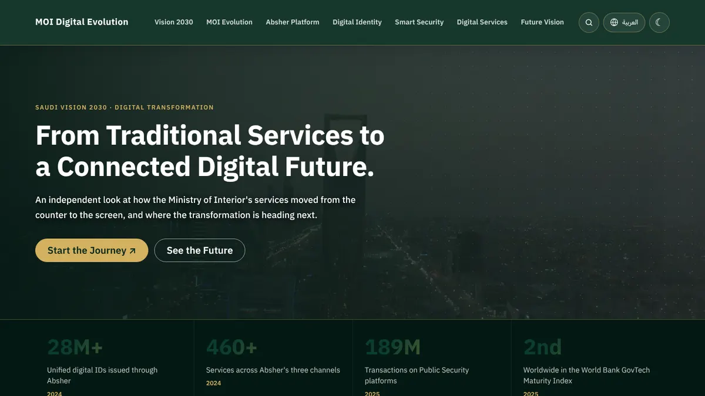
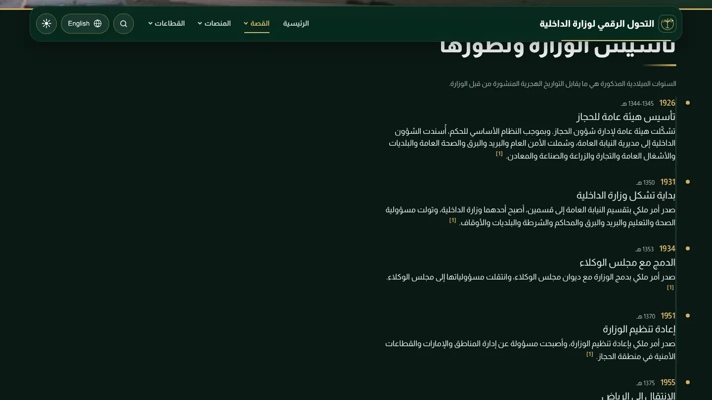
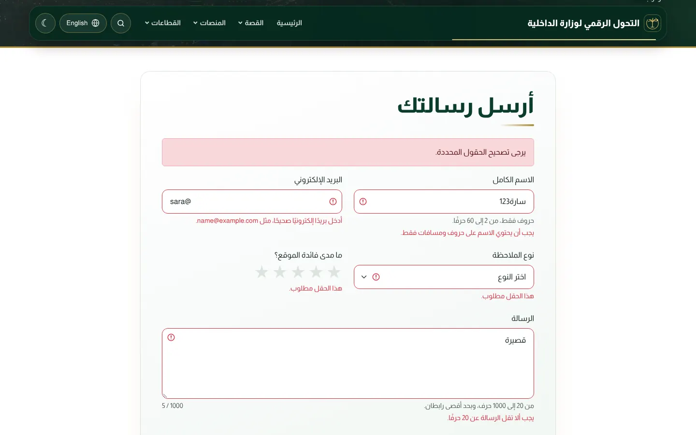
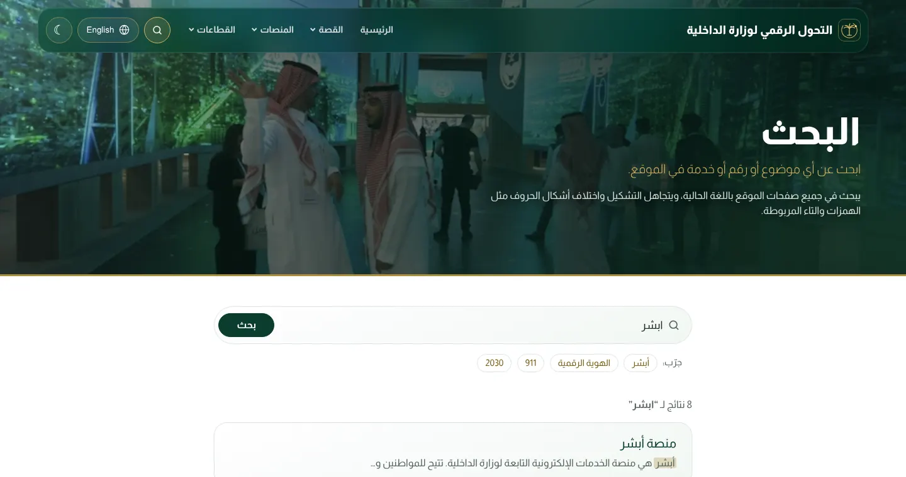
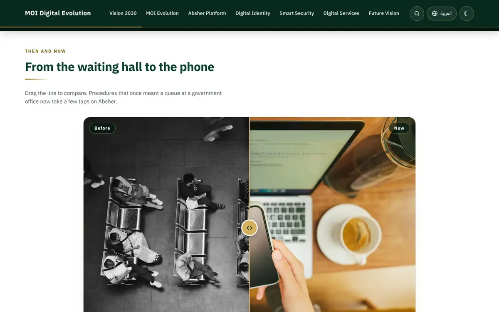
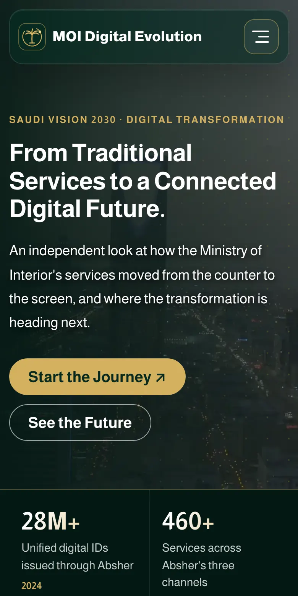
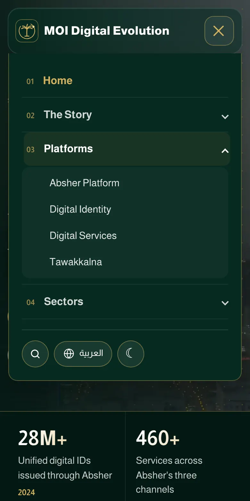

# MOI Digital Evolution

**From traditional services to a connected digital future.**

A bilingual (Arabic / English) Django website about how the Saudi Ministry of Interior's services moved from the counter to the screen, as part of Saudi Vision 2030. Every figure on the site carries its source and the date it refers to.

> Independent educational project for the Tuwaiq Academy bootcamp (UNIT-PROJECT-2). Not affiliated with or endorsed by the Ministry of Interior.



---

## Pages

| URL | Page |
| --- | --- |
| `/` | Home: hero video, impact numbers, before/after slider, photo cards for every page |
| `/vision-2030/` | Vision 2030 |
| `/moi-evolution/` | MOI Evolution: timeline from 1926 to today, Hijri and Gregorian dates |
| `/absher/` | Absher Platform |
| `/digital-identity/` | Digital Identity |
| `/smart-security/` | Smart Security |
| `/digital-services/` | Digital Services |
| `/future-vision/` | Future Vision |
| `/search/` | Site search |
| `/feedback/` | Share your feedback (saved to the database) |
| `/admin/` | Django admin: review feedback |

---

## Assignment requirements

| Requirement | How this project meets it |
| --- | --- |
| Use Django | Django 6.1, one app: `portal` |
| Templates and template inheritance | Every page extends `templates/portal/base.html`; shared parts live in `templates/portal/partials/` (navbar, footer, cards, stats, timeline, sources) |
| Dynamic URLs | `path("<slug:slug>/", views.content_page)` serves all seven content pages from one view |
| Static files | CSS, JavaScript, WebP images and the hero video under `portal/static/portal/` |
| Home page + at least 6 pages | Home + 7 content pages + Search + Feedback |
| Coherent, uniform design | One stylesheet, one set of color tokens (dark green, white, gold), one font for both languages |
| Dark and light mode | Toggle in the navbar, saved in `localStorage`, applied before the page paints |
| Responsive | Tested at 390, 1000, 1200, 1366 and 1500 px wide, no horizontal scroll |
| CSS library | Bootstrap 5.3 (RTL build for Arabic) |

---

## Beyond the requirements

**Arabic and English with full RTL.** The language is stored in the session. Each page reads its content from `portal/data/<page>.json` or `portal/data/ar/<page>.json`, and Arabic pages load Bootstrap's RTL stylesheet.



**Feedback form with server-side validation.** A `Feedback` model, saved to SQLite and listed in the Django admin. Every error message appears in the current language.

| Invalid input | Where it is rejected |
| --- | --- |
| Empty fields, or spaces only | `required` on every field |
| Name with digits or symbols | `FeedbackForm.clean_name` |
| Invalid email | `EmailField` |
| Feedback type changed in DevTools | `ChoiceField`, values come from `Feedback.Category` |
| Rating outside 1 to 5 | `TypedChoiceField` |
| Message of symbols only, or more than 2 links | `FeedbackForm.clean_message` |
| Bot filling the hidden field | Honeypot check in `FeedbackForm.clean` |
| Two messages within a minute | `sent_feedback_recently` in `views.py` |

After a successful submit the view redirects (Post/Redirect/Get), so refreshing the page does not send the form again.



**Arabic-aware search.** `portal/search.py` removes diacritics and unifies letter forms (أ إ آ → ا, ة → ه, ى → ي) before matching, so "ابشر" finds "أبشر". Matches are highlighted, and all page text is HTML-escaped before the highlight is added.



**Before/after slider.** A real `<input type="range">` drives a CSS variable, so it works with mouse, touch and keyboard, and follows the reading direction in Arabic.



**Photo galleries.** Every inner page has an "In Pictures" section: a `gallery` section type in the page's JSON, rendered by `partials/gallery.html`. Each photo has a caption in both languages, used as its alt text.

**Motion with care.** Hero video (compressed from 13.6 MB to 0.87 MB, with a poster image while it loads), counting numbers, reading-progress bar, and an animated menu button. All of it stops when the visitor's device asks for reduced motion.

<p>
  
  
</p>

---

## Run it locally

Requires Python 3.12 or later.

```bash
git clone https://github.com/muathhhh/UNIT-PROJECT-2.git
cd UNIT-PROJECT-2

python -m venv venv
source venv/Scripts/activate      # Windows (Git Bash)
# source venv/bin/activate        # macOS / Linux

pip install -r requirements.txt
cp .env.example .env              # then put your own key in .env (see below)
python manage.py migrate          # creates the feedback and session tables
python manage.py runserver
```

Open http://127.0.0.1:8000/

To review feedback in the admin:

```bash
python manage.py createsuperuser
```

Then sign in at http://127.0.0.1:8000/admin/

> `migrate` is required: the language switch stores the choice in Django's session table, and the feedback form saves to its own table.

### Environment variables

Settings that differ between machines are read from a `.env` file (loaded by `python-dotenv`). `.env` is in `.gitignore`, so secrets never reach GitHub; `.env.example` shows its shape.

| Variable | Default | Purpose |
| --- | --- | --- |
| `DJANGO_SECRET_KEY` | a random key made at startup | Signs sessions and CSRF tokens |
| `DJANGO_DEBUG` | `True` | Set to `False` in production |
| `DJANGO_ALLOWED_HOSTS` | `127.0.0.1,localhost` | Comma-separated host names |

Generate a key:

```bash
python -c "from django.core.management.utils import get_random_secret_key; print(get_random_secret_key())"
```

To see the custom 404 page locally, set `DJANGO_DEBUG=False` in `.env` and run `python manage.py runserver --insecure` (the flag keeps static files served).

---

## Tests

```bash
python manage.py test portal
```

50 tests cover every invalid-input case above, plus:

- all seven pages load in both languages
- unknown URLs return a 404 page that offers search and links to every page
- the secret key is not written in `settings.py`
- the language switch accepts only `en` and `ar`, and refuses to redirect to another site
- search ignores empty, too short, too long and symbols-only queries, finds Arabic words without hamza, and escapes HTML
- the before/after images exist and the slider renders in both languages
- every gallery photo exists and has a caption in both languages, and search finds words in captions


---

## Project structure

```
.env.example              template for your local .env
config/
  settings.py             reads DJANGO_* values from .env
  urls.py                 admin, favicon redirect, portal URLs
portal/
  data/                   page content in English
  data/ar/                page content in Arabic
  migrations/0001_initial.py
  static/portal/
    css/main.css
    js/theme.js           theme toggle, counters, navbar, slider, character counter
    img/                  WebP images, gallery/, favicon
    video/hero-riyadh.mp4
  templates/portal/
    base.html             layout every page extends
    home.html  page.html  search.html  feedback.html  404.html
    partials/             navbar, footer, cards, stats, timeline, gallery, sources
  forms.py                FeedbackForm, SearchForm
  models.py               Feedback
  search.py               Arabic normalization, scoring, highlighted snippets
  tests.py
  urls.py
  views.py
docs/screenshots/         images used in this README
```

---

## Tech stack

Django 6.1 · Python · SQLite · python-dotenv · Bootstrap 5.3 · vanilla JavaScript · IBM Plex Sans Arabic

## Sources and media

Figures come from official and news sources cited on each page, with the date each figure refers to. The hero video and several photos are from [Pexels](https://www.pexels.com/). Photos are used for this non-commercial educational project.
