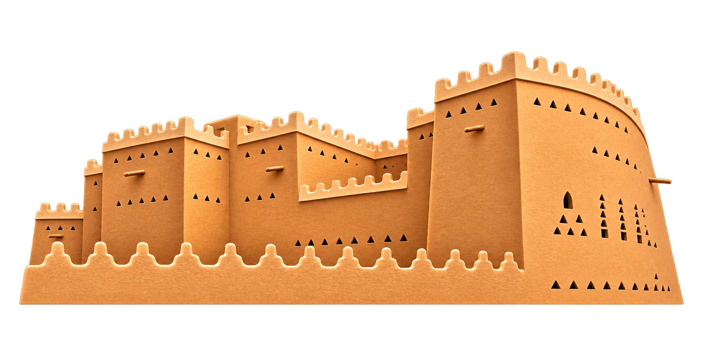
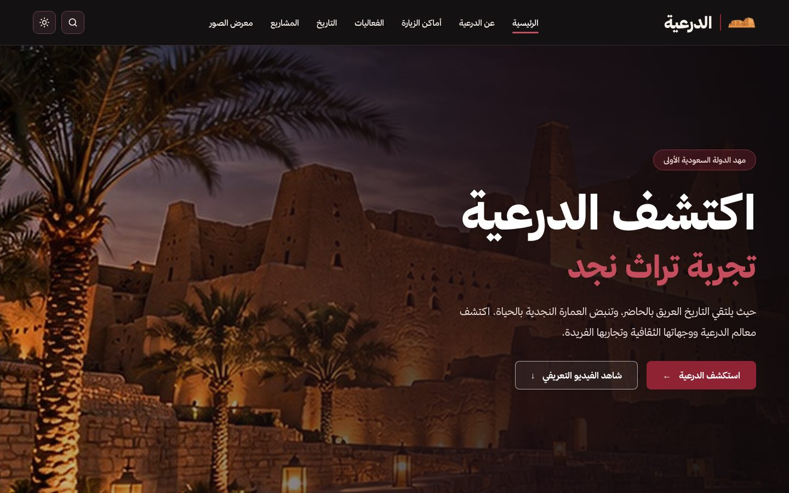

<div align="center">



# الدرعية | Diriyah

**موقع تعريفي بالدرعية، مهد الدولة السعودية الأولى**



</div>

<br>


---

## 📖 نبذة

يعرض الموقع تاريخ الدرعية وأبرز أماكن الزيارة والفعاليات والمشاريع الكبرى ومعرض صور، مع بحث داخلي وفيديو تعريفي.


<br>

---

## 🗺️ الصفحات

<div align="center">

| الصفحة | المسار |
|:---:|:---:|
| الرئيسية | `/` |
| عن الدرعية | `/about/` |
| أماكن الزيارة | `/places/` |
| تفاصيل مكان | `/places/<slug>/` |
| الفعاليات | `/events/` |
| التاريخ | `/history/` |
| المشاريع | `/projects/` |
| تفاصيل مشروع | `/projects/<slug>/` |
| المعرض | `/gallery/` |
| البحث | `/search/` |

</div>

<br>


### 📍 أماكن الزيارة

- الزلّال

- باب سمحان

- حي الطريف التاريخي

- مطل البجيري

- وادي حنيفة

<br>


### 🏗️ المشاريع

- ميدان الدرعية

- وادي صفار

- دار الأوبرا الملكية بالدرعية

- حي القرين الثقافي

- مركز الدرعية لفنون المستقبل

<br>


---

## ✨ المميزات

- وضع داكن وفاتح مع حفظ اختيار المستخدم

- بحث داخلي في الأماكن والمشاريع

- خط زمني تفاعلي لتاريخ الدرعية من 1446م إلى 2023م

- فيديو تعريفي ومعرض صور

- تصميم متجاوب مع الجوال والتابلت وسطح المكتب

- دعم كامل للغة العربية والاتجاه من اليمين لليسار

<br>


---

## 🛠️ التقنيات

<div align="center">

| التقنية | الاستخدام |
|:---:|:---:|
| Python | لغة البرمجة |
| Django | إطار بناء الموقع |
| HTML | هيكل الصفحات |
| CSS | التصميم والألوان |
| JavaScript | حركة الخط الزمني |

</div>

<br>


---

## 🚀 التشغيل

**1. إنشاء البيئة الافتراضية**

```bash
python -m venv venv
```

**2. تفعيل البيئة**

على ويندوز:

```bash
venv\Scripts\activate
```

على ماك / لينكس:

```bash
source venv/bin/activate
```

**3. تثبيت Django**

```bash
pip install django
```

**4. تشغيل الموقع**

```bash
python manage.py runserver
```

<br>

ثم افتح الرابط: `http://127.0.0.1:8000/`
