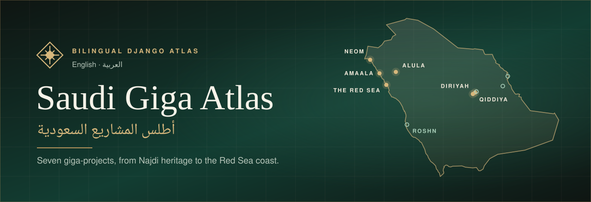
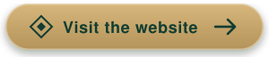

<p align="center">
  
</p>

<p align="center">
  <a href="https://saudi-giga-atlas.onrender.com">
    
  </a>
</p>

<p align="center">
  
  
  
  
  
</p>

## About

**Saudi Giga Atlas** is a bilingual guide, in English and Arabic, to seven of Saudi Arabia's largest destinations and developments: NEOM, Qiddiya, Diriyah, ROSHN, The Red Sea, AMAALA and AlUla.

Each project has its own page with photographs, key facts, milestones, a short film and its place on the map.

## Features

- **English and Arabic.** The full site is translated, and the Arabic pages read right to left.
- **Interactive map.** A 3D relief map of the Kingdom built from real elevation data, with every project marked.
- **Project pages.** A photo gallery, facts, milestones, things to do and a short film for each project.
- **Timeline.** Every project's milestones on one shared time axis, which you can filter by project.
- **Compare.** All seven projects side by side in one table.
- **Search.** Live results with the matching words highlighted, in either language.
- **Light and dark themes**, responsive layouts and accessible markup.

## Built with

| Layer | Tools |
| --- | --- |
| Backend | Django 6.1, WhiteNoise, Gunicorn |
| Frontend | Vite, Tailwind CSS, three.js |
| Media | Cloudflare R2 for the films; AVIF and WebP images |
| Deploy | Docker on Render |

## Project structure

```
saudi_atlas/
├── projects/          the app
│   ├── data/          project records, map geometry and credits (JSON)
│   ├── frontend/      JavaScript and CSS source, built by Vite
│   ├── locale/        Arabic translations
│   ├── static/        images, posters, captions and icons
│   ├── templates/     page templates
│   ├── templatetags/  template helpers
│   ├── views.py
│   └── urls.py
├── settings.py
├── urls.py
└── wsgi.py
```

## Run locally

You need Python 3.15 and Bun 1.4.4.

```bash
python -m venv .venv
.venv\Scripts\activate
pip install -r requirements.txt
bun install
bun run build
python manage.py compiletranslations
python manage.py runserver
```

Then open http://127.0.0.1:8000/ for English or http://127.0.0.1:8000/ar/ for Arabic.

To run the tests:

```bash
python manage.py test
```

## Deploy

The repository deploys to [Render](https://render.com) as a Blueprint. In Render, choose **New > Blueprint**, connect this repository and click **Deploy Blueprint**. Render builds the `Dockerfile`, which builds the frontend, compiles the translations, collects static files and starts Gunicorn.

| Variable | Purpose |
| --- | --- |
| `ATLAS_DEBUG` | Set to `0` in production. |
| `ATLAS_HTTPS` | Set to `1` to turn on the HTTPS redirect, HSTS and secure cookies. |
| `ATLAS_SECRET_KEY` | Django's secret key. Render generates one. |
| `ATLAS_ALLOWED_HOSTS`, `ATLAS_CSRF_TRUSTED_ORIGINS` | Only needed for a custom domain. Render's own hostname is added automatically. |
| `ATLAS_VIDEO_BASE_URL` | Where the films are hosted. It defaults to the project's Cloudflare R2 bucket. |

## Credits

Photographs, films, map data and typefaces are credited on the site's [Credits page](https://saudi-giga-atlas.onrender.com/credits/).
