<div align="center">


### Six giga-projects, six designs, built on Saudi Vision 2030

A Django website about the giga-projects shaping Saudi Arabia's future.
Each project has its own handcrafted page, and every animation and interactive part is pure CSS.


<br>

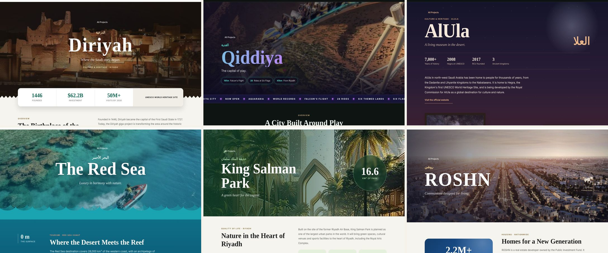

</div>

---

## ✨ Highlights

| | |
|---|---|
| 🎨 **Six designs** | Every project page has its own visual concept: Najdi, neon, museum, ocean, garden and neighbourhood. |
| ⚡ **Zero JavaScript** | All animations, maps, tabs and explorers are built with HTML and CSS only. |
| 🌗 **Dark & light mode** | The theme is saved in a cookie and handled by Django, so it works without JavaScript too. |
| 📱 **Responsive** | Layouts are tested at desktop, tablet and phone widths with no horizontal scrolling. |
| ♿ **Accessible motion** | Every animation respects `prefers-reduced-motion`. |
| 🗂️ **Data-driven** | All project content lives in one JSON file and is rendered through Django templates. |

---

## 🏗️ The Projects

Each project gets a custom template. If a project has no custom page yet, Django falls back to a shared detail template.

| | Project | Concept | Signature CSS |
|---|---|---|---|
| 🏰 | **Diriyah** · الدرعية | Najdi heritage | Najdi zig-zag edges with `conic-gradient` masks and a floating stats strip |
| 🎢 | **Qiddiya** · القدية | Neon theme park | Gradient text, an infinite ticker, and gauges animated with `@property` |
| 🏛️ | **AlUla** · العلا | Desert museum | Exhibition "rooms" on a deep gradient, with twinkling stars in dark mode |
| 🌊 | **The Red Sea** · البحر الأحمر | A dive into the sea | Depth zones from the surface to the reef, with numbers that count up as you scroll |
| 🌳 | **King Salman Park** · حديقة الملك سلمان | Green capital | A tilted 3D masterplan drawn in CSS, with standing pins, a glowing loop and a scene for each place |
| 🏘️ | **ROSHN** · روشن | Neighbourhood life | A map of Saudi Arabia drawn with `clip-path`, and a photo that changes from day to night with the theme |

---

## 🎬 See It in Motion

Everything below runs on HTML and CSS only.

<p align="center">
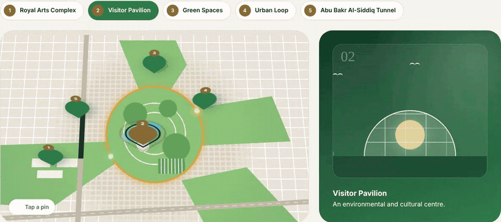
<br><sub><b>King Salman Park</b>: a 3D masterplan. Pick a place and the pin and scene change.</sub>
</p>

<table>
<tr>
<td width="50%">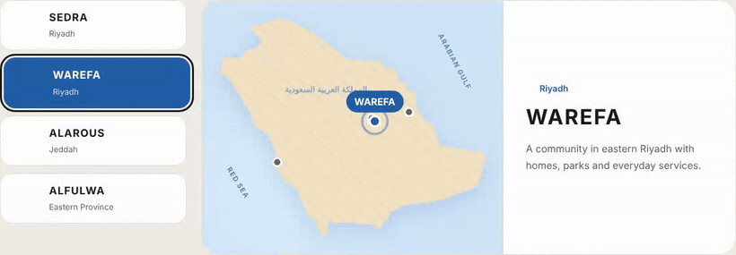</td>
<td width="50%">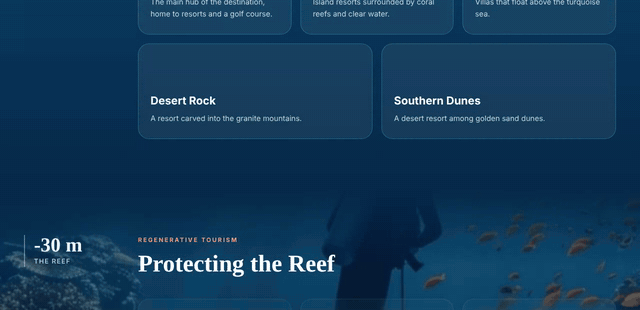</td>
</tr>
<tr>
<td align="center"><sub><b>ROSHN</b>: each community lights up on the map</sub></td>
<td align="center"><sub><b>The Red Sea</b>: numbers count up as you scroll</sub></td>
</tr>
</table>

<p align="center">
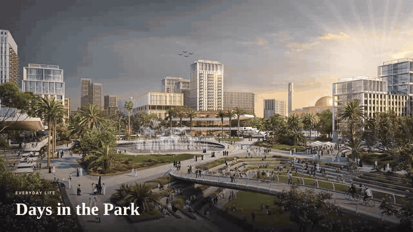
<br><sub><b>ROSHN</b>: sun rays, a sparkling fountain and birds over a photo. In dark mode it becomes night in SEDRA.</sub>
</p>

---

## 🪄 How It Works Without JavaScript

| Feature | Technique |
|---|---|
| Interactive maps, tabs and explorers | Hidden radio inputs + `<label for>` + `:checked ~` sibling selectors |
| A 3D masterplan with standing pins | `perspective` + `transform-style: preserve-3d` + `rotateX()` |
| Lights moving around the park loop | `offset-path` with an animated `offset-distance` |
| Number counters (e.g. **2.2M+**) | `@property` integers + `counter-reset` + `content: counter()` |
| Numbers that count as you scroll | The same counters on `animation-timeline: view()` |
| A map of Saudi Arabia | `clip-path: polygon()` built from real coordinates |
| Day and night photo scenes | The theme cookie swaps the photo, with glowing lights placed on top |
| Gauges and progress bars | Animated custom properties registered with `@property` |
| Reveal on scroll | `animation-timeline: view()` inside `@supports` |
| Traditional Najdi edges | `conic-gradient` masks and `clip-path` shapes |
| Theme switching | A Django view that sets a `site_theme` cookie, read in `base.html` |

---

## 📄 Pages

| Page | URL | Description |
|---|---|---|
| Home | `/` | Hero, the Vision in brief, the Riyadh Metro video, a quote from HRH the Crown Prince, and featured projects |
| All Projects | `/projects/` | Search by name, city or category, plus category filters |
| Project | `/project/<slug>/` | A custom page for each giga-project |
| About | `/about/` | Vision 2030: pillars, progress, milestones and leadership |
| Theme | `/theme/<light\|dark>/` | Switches the theme and returns you to the same page |

<table>
<tr>
<td width="50%">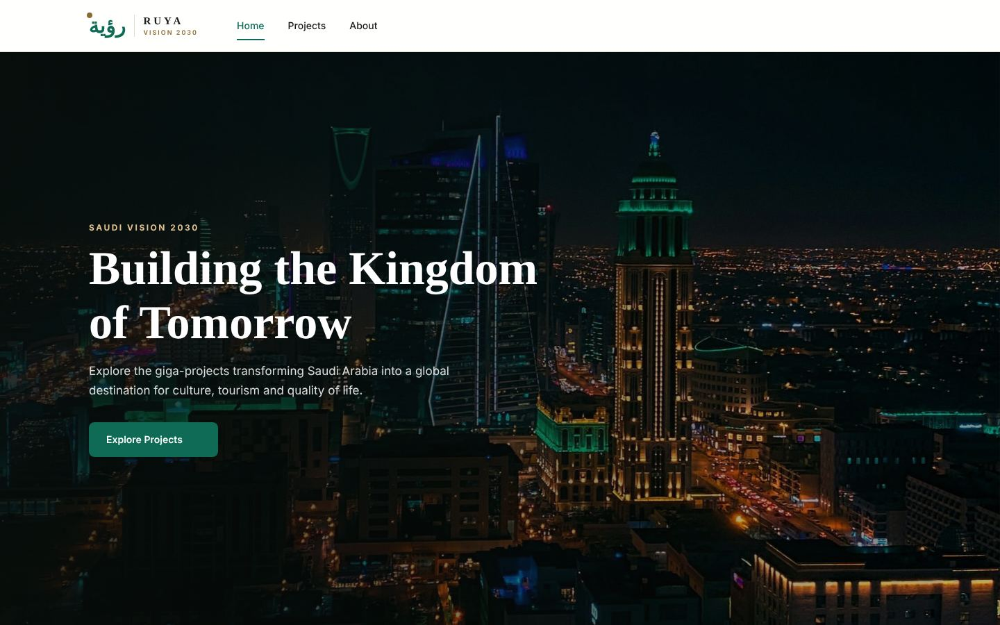</td>
<td width="50%">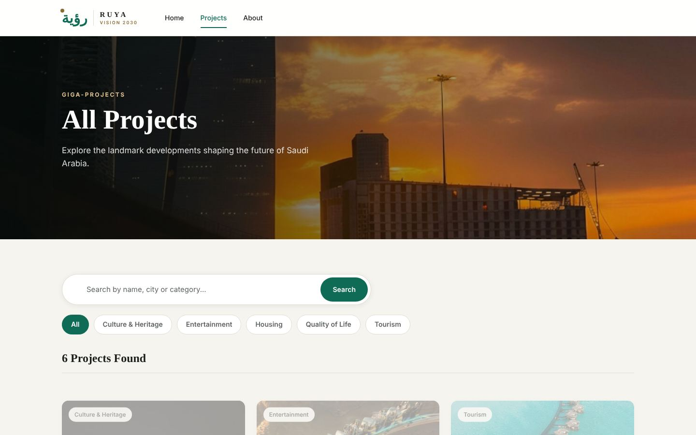</td>
</tr>
<tr>
<td width="50%">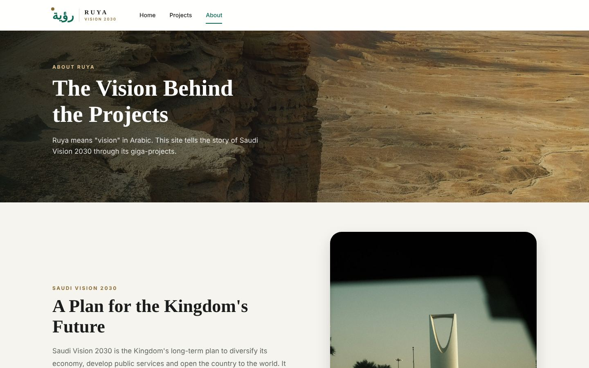</td>
<td width="50%">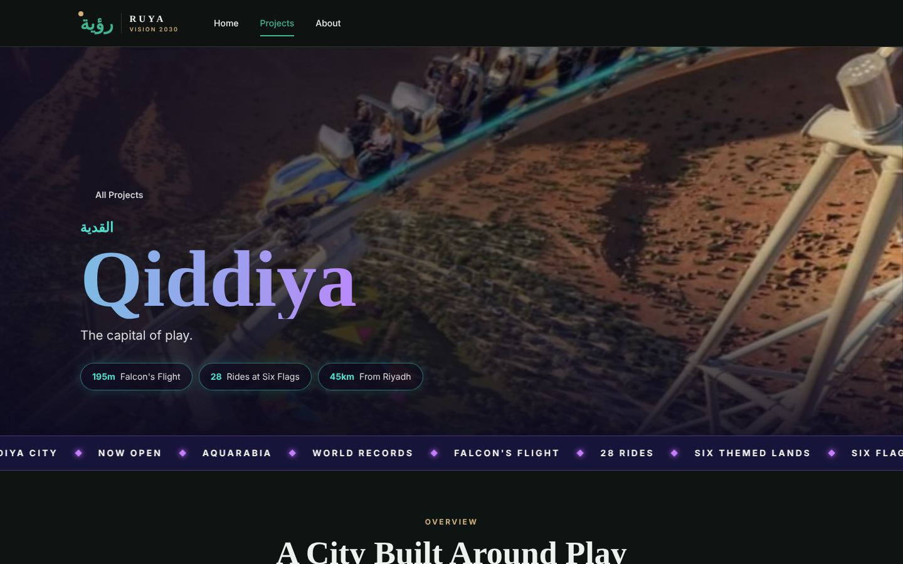</td>
</tr>
</table>

<p align="center">
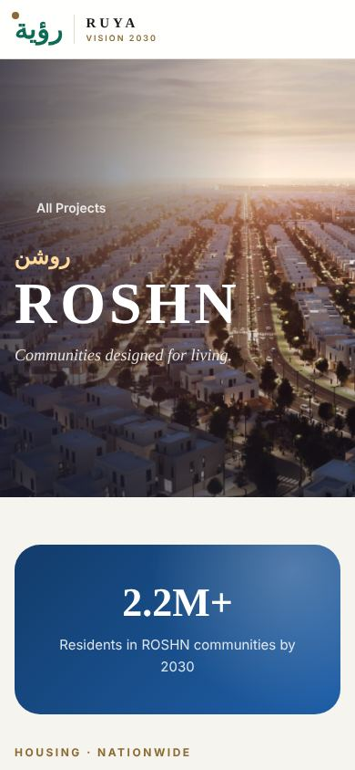
&nbsp;&nbsp;
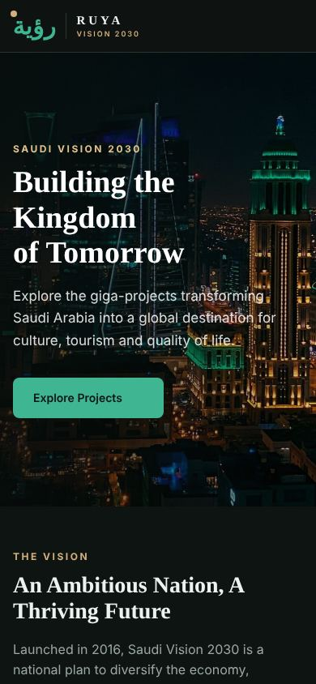
</p>

---

## 🧱 Tech Stack

- **Backend:** Python, Django (function-based views, URL namespacing, template inheritance)
- **Frontend:** HTML5 and CSS3 (custom properties, Grid, Flexbox, `@property`, scroll-driven animations)
- **Data:** JSON (`projects/data/projects.json`)
- **Fonts and icons:** Inter, Playfair Display, Noto Kufi Arabic and Material Symbols (Google Fonts)

---

## 📁 Project Structure

```
UNIT-PROJECT-2/
├── manage.py
├── docs/                      # README banner, screenshots and GIFs
├── requirements.txt
├── Ruya/                      # Django project settings
└── projects/                  # The main app (app_name = 'projects')
    ├── views.py               # home, all_projects, project_detail, about, set_theme
    ├── urls.py
    ├── data/
    │   └── projects.json      # Content for all six projects
    ├── templates/projects/
    │   ├── base.html          # Header, footer and theme
    │   ├── home.html
    │   ├── all_projects.html
    │   ├── about.html
    │   ├── project_detail.html    # Generic fallback page
    │   ├── diriyah.html           # Custom pages, one per project
    │   ├── qiddiya.html
    │   ├── alula.html
    │   ├── red-sea.html
    │   ├── king-salman-park.html
    │   ├── roshn.html
    │   ├── project_card.html      # Shared partials
    │   ├── project_gallery.html
    │   └── more_projects.html
    └── static/
        ├── css/style.css
        ├── images/<project>/  # One folder per project
        ├── videos/
        └── audio/
```

The custom page with a fallback is a single line in `views.py`:

```python
templates = [f'projects/{project_slug}.html', 'projects/project_detail.html']
return render(request, templates, context)
```

---

## 🚀 Getting Started

```bash
# 1. Clone the repository
git clone https://github.com/<your-username>/UNIT-PROJECT-2.git
cd UNIT-PROJECT-2

# 2. Create and activate a virtual environment
python -m venv venv
source venv/bin/activate        # Windows: venv\Scripts\activate

# 3. Install the requirements
pip install -r requirements.txt

# 4. Run the server
python manage.py runserver
```

Then open **http://127.0.0.1:8000** in your browser.

### Adding a new project

1. Add an entry to `projects/data/projects.json` with a unique `slug`.
2. Put its images in `projects/static/images/<slug>/`.
3. *(Optional)* Create `templates/projects/<slug>.html` for a custom design. Without it, the generic page is used.

---

## 📚 Sources & Credits

### Content
- [Saudi Vision 2030](https://www.vision2030.gov.sa): the official Vision portal
- [Saudipedia](https://saudipedia.com): Vision 2030 facts and milestones
- [Public Investment Fund](https://www.pif.gov.sa): ROSHN and the giga-projects
- [Arab News](https://www.arabnews.com) and [Gulf News](https://gulfnews.com): news coverage of the projects
- [Wikipedia](https://en.wikipedia.org): background on King Salman Park and the other projects
- [Attractions Daily](https://attractionsdaily.com): Qiddiya rides and records

### Images & Media
| Folder | Source |
|---|---|
| `diriyah/` | Official Diriyah media ([diriyah.sa](https://www.diriyah.sa)) and photographers' work |
| `qiddiya/` | Official Qiddiya media ([qiddiya.com](https://qiddiya.com)) |
| `alula/` | Official AlUla media ([experiencealula.com](https://www.experiencealula.com)) |
| `red-sea/` | Official Red Sea Global media ([redseaglobal.com](https://www.redseaglobal.com)) |
| `king-salman-park/` | Official King Salman Park media ([kingsalmanpark.sa](https://www.kingsalmanpark.sa)) |
| `roshn/` | Official ROSHN media ([roshn.sa](https://www.roshn.sa)) |
| `site/` | Riyadh photography and official photos of the Saudi leadership |

**Photography credits:** some photos are by **Ahmad Alhamwan** and **Osama Mansour**. All rights belong to their owners.

---


---

<div align="center">

Made with 💚 for Saudi Arabia 🇸🇦

**Sami Al-Harbi**

</div>
